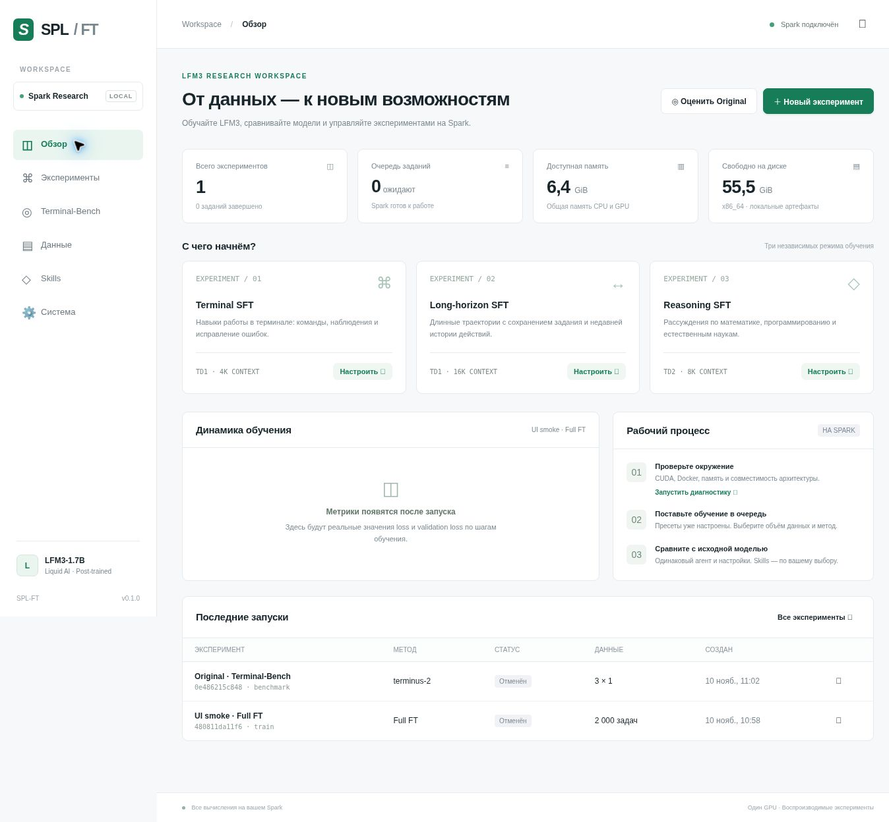

# SPL-FT

A local, browser-based LFM3 training workbench for NVIDIA DGX Spark. Prepare reproducible datasets, queue independent experiments, train LoRA or all weights, and evaluate original and trained models with Terminal-Bench 2.1 and optional skills.



## Start on Spark

```bash
git clone https://github.com/crystalcali/SPL-FT.git
cd SPL-FT
bash scripts/setup.sh
bash scripts/start.sh
```

Open **http://SPARK_IP:7860** from your computer. Paste the access key printed in the terminal. To display it again:

```bash
.venv/bin/spl-ft token
```

No Node.js, database server, vLLM, paid API, or external experiment tracker is needed. The web application runs directly on Spark. The first setup installs CUDA PyTorch, training packages and Harbor. On ARM64 it registers AMD64 emulation using a privileged `tonistiigi/binfmt` container and verifies an x86 container. Docker and Docker Compose must already work for your user (normally included on Spark).

The app listens on all network interfaces and requires an access key. Use a trusted LAN or an SSH tunnel/VPN; the built-in HTTP server does not provide TLS. Each instance has one shared workspace and access key. It is not a multi-tenant service.

```bash
# Optional tunnel from your computer:
ssh -L 7860:127.0.0.1:7860 userdgx1@SPARK_IP
# Then open http://127.0.0.1:7860
```

## Minimal workflow

1. Open **Система** and run diagnostics.
2. On **Обзор**, select Terminal, Long-horizon or Reasoning SFT.
3. Set the sample size and choose **LoRA** or **Full fine-tuning**. Everything else has defaults. The method selector reduces the default learning rate to 1e-5 for full training.
4. Optionally enable automatic benchmark after training; click **Добавить в очередь**.
5. Evaluate **Original** and the trained versions with the same benchmark settings. Upload `SKILL.md` or ZIP folders on **Skills** and choose them per evaluation.

Jobs run sequentially, including managed model serving and evaluation. The worker does not stop other model servers on your Spark. Stop unrelated GPU-heavy workloads yourself if there is insufficient available memory. Queue state, logs, metrics, models, checkpoint states, skill snapshots, and data manifests persist under `.spl-ft/`. The queue can pause, reorder priorities through the API, cancel, retry, and resume interrupted training from a complete saved checkpoint.

## Three independent recipes

| Recipe | Dataset | Default context | Default method | Default sample |
|---|---|---:|---|---:|
| Terminal SFT | TD1: NVIDIA Nemotron Terminal Corpus, all four subsets | 4,096 | LoRA r16 | 2,000 unique tasks |
| Long-horizon SFT | The same TD1 pool and split seeds | 16,384 | LoRA r16 | 2,000 unique tasks |
| Reasoning SFT | TD2: OpenThoughts3-1.2M | 8,192 | LoRA r16 | 2,000 unique tasks |

Each starts from **`LiquidAI/LFM3-1.7B`**, the post-trained checkpoint, not its Base version. All recipes support full weight training. BF16, micro batch 1, gradient accumulation 16 and gradient checkpointing are defaults. Context lengths and batch sizes are starting configurations, not measured Spark capacity guarantees. An out-of-memory failure remains visible and can be retried with smaller settings; the app never silently changes your experiment.

Training uses Transformers Trainer with precomputed assistant-only labels and PEFT for LoRA. The complete Trainer configuration is validated before dataset preparation; the pinned Transformers 5.20 recipe uses `warmup_steps=0.05` for 5% warmup. The module list follows Liquid's SFT cookbook. Using explicit labels preserves the model's native generation mask for multi-turn trajectories; no loss is applied to user messages or terminal observations. The pinned model revision includes remote modeling code and tokenizer/template. Research recipes use the native BF16 model, not a quantized inference checkpoint.

## Reproducible sampling

The first preparation streams **all selected source subsets** to obtain an unbiased hash-based sample over distinct normalized task prompts. This can take significant time and network traffic for these large corpora. A bounded disk pool retains candidate examples; the entire source corpus is not materialized as a second full local copy. Identical completed configurations are cached.

- `split_seed` fixes holdout selection independently of training sample size and `sample_seed`.
- `sample_seed` controls the training sample. `training_seed` controls training randomness separately.
- Validation and test contain 100 unique tasks each by default.
- Duplicate prompt variants stay together. One deterministically selected trajectory is retained per task; the UI's sample size counts unique tasks, not raw rows.
- For Terminus-style TD1 messages, the generic instruction prefix and volatile initial terminal screen are removed **only from the grouping key**, never from the training messages.
- Manifests save source revision, subset selection, selected IDs and task groups. A source revision and split parameters must stay identical when comparing experiments. Pin `dataset_revision` when creating a series over several days.
- `scan_limit` is an optional fast pilot over the first N source records. It is explicitly marked **prefix_sample**, not described as a globally random sample. Holdout stability requires the same scan limit too.

Source Parquet files are read directly with `ParquetFile.iter_batches(batch_size=16, use_threads=False)`, bypassing the Hugging Face Dataset Scanner path that fails on very large nested conversation columns. Reducing the scanner batch size alone is insufficient on TD1. Rows are read in deterministic shard order from the pinned HF revision; the reader does not skip failing files or change the split seeds.

Exact prompt normalization catches exact/format duplicates, not arbitrary paraphrases or semantic overlap. Terminal-Bench tasks and solutions are never used as a training source. Cross-corpus semantic decontamination against the benchmark is not claimed.

## Long histories and loss

A trajectory that fits is trained whole. Otherwise the app creates one target-assistant-turn window per decision, preserving the initial task and the most recent complete messages that fit. Prior assistant turns in that window are context-only, so their loss is not counted twice. An orphaned tool response is not retained as the first recent message. If the task plus a single target answer is too large, that target is dropped and counted; there is no silent token truncation.

This is history-window SFT, not hidden-state compression and not a claim to train every trajectory end-to-end. Longer contexts preserve more history. The artifacts report accepted windows, input tokens, assistant loss tokens and dropped turns per split. Validation loss is logged during training. The fixed corpus test loss is evaluated once at the end of each completed training run; it is distinct from Terminal-Bench success rate.

## Terminal-Bench 2.1

Harbor **0.25.0** resolves the official Hugging Face task snapshot. The runner pins and records the exact dataset revision, task list and checksums, agent and package versions, architecture, model revision and skill snapshots. Internet access is needed to download task images and task dependencies. If access to the mirror requires authentication, run:

```bash
.venv/bin/hf auth login
```

The default agent is **Terminus 2**: real TD1 trajectories use its JSON command format, so it is the most direct training/evaluation match. **OpenCode** is an optional second harness, useful when comparing with Liquid's published model-card setup. Its package version is resolved once per evaluation and pinned across that run; it is installed by Harbor inside each task environment and needs working package-network access there. The turn limit applies to Terminus; OpenCode follows each task's timeout.

The runner starts an authenticated, temporary OpenAI-compatible Transformers endpoint, loads the Original/full model or merges a LoRA adapter in memory, then stops the endpoint after evaluation. Generation is serialized for predictable memory use. It supports native LFM3 reasoning and XML tool calls, and buffered SSE responses for clients that request streaming. It is a compatibility implementation, not a high-throughput vLLM replacement.

Terminus reaches inference on host loopback; OpenCode reaches it through `host.docker.internal` with a Docker host-gateway mapping. Neither task environments nor agents receive your GitHub credentials. The temporary inference key is supplied through an environment variable.

**ARM64 note:** On Spark the default benchmark architecture is AMD64 emulation to preserve x86 task images. This costs CPU performance and may affect timed tasks. Such results record their architecture and are grouped separately from native results. Registering QEMU cannot guarantee every benchmark's nested virtualization, networking or binary requirement works. Infrastructure failures are surfaced, not hidden or counted as solved tasks. Native ARM is available as an advanced option; portability of all tasks is not assumed.

The browser offers all 89 tasks, a first-3-task smoke run, first 10 tasks, name filters and multiple attempts. These subsets are labelled as partial evaluations; they are not full benchmark scores. A complete leaderboard entry requires all scheduled attempts to have valid grades. The primary displayed success rate is solved / scheduled attempts; infrastructure errors cannot increase it by reducing the denominator. Exact comparison groups include benchmark tasks, architecture, agent and its version, Harbor version, skills, context, sampling, seed, output limits and attempts. `graded_success_rate` is diagnostic only. This workbench's leaderboard is local; it does not publish submissions.

## Skills

Upload a single `SKILL.md`, a ZIP containing one skill directory, or a ZIP containing several immediate child skill directories. Expanded archives are bounded and path traversal and symbolic links are rejected. Each benchmark receives a copy; changing uploaded files later cannot change an earlier run. A general-purpose example is in `skills/terminal-practice/`. Skills should describe general procedures, not benchmark-specific answers.

## Persistence and configuration

| Variable | Default | Use |
|---|---|---|
| `SPL_FT_HOME` | repository `.spl-ft/` when using start.sh | Persistent workspace location |
| `SPL_FT_HOST` | `0.0.0.0` | Web listen interface |
| `SPL_FT_PORT` | `7860` | Web port |
| `SPL_FT_TOKEN` | generated on first launch | Optional shared access key |
| `HF_TOKEN` | existing HF login | Optional gated downloads / rate limit |

No credentials belong in the repository. The generated access key is stored with mode 0600. Back up the entire workspace and the Hugging Face cache to preserve model and dataset dependencies. Training checkpoints include optimizer/RNG state. On restart an in-flight job is marked interrupted; use its resume button to create a new run from the latest complete checkpoint. Retry of a benchmark is a new full run, preserving the earlier result.

## Checks and limitations

```bash
bash scripts/setup.sh --ui-only
.venv/bin/pytest -q
node --check spl_ft/static/app.js  # optional development check; Node not needed to run
```

CPU tests exercise grouped sampling, stable test membership, native loss-mask/window handling, queue recovery/cancellation/dependencies, API authentication, unsafe skill uploads and benchmark denominators/configuration. Opt-in real LFM3 tokenizer and tiny native-architecture CPU training tests are available with `SPL_FT_TOKENIZER_PATH=/path/to/local/snapshot` and `SPL_FT_MODEL_CODE_PATH=/path/to/local/snapshot`. These use actual model code with tiny random weights, not the full 1.7B model. See [verification notes](docs/VERIFICATION.md).

GPU training and Docker task execution must be validated on the actual Spark. This repository does not contain fabricated benchmark scores. Run a small training experiment (`max_steps=2`, low sample sizes) and a 3-task benchmark smoke before scheduling long runs. Full weight training stores much larger checkpoints than LoRA. The first corpus scan and container builds may dominate preparation time.

If a setup download fails, rerun setup; it is safe to repeat. If Docker is unavailable, fix Docker user access and Compose, then rerun diagnostics. If AMD64 commands fail with `exec format error`, rerun `bash scripts/enable-amd64.sh`. If GPU memory is occupied, stop unrelated serving containers before training. If a benchmark fails, inspect `console.log`, `inference.log`, and Harbor's per-trial logs under the run's Artifacts tab.

## Sources

- [LFM3 post-trained model](https://huggingface.co/LiquidAI/LFM3-1.7B)
- [Liquid official SFT cookbook](https://github.com/Liquid4All/cookbook/blob/main/finetuning/notebooks/lfm3_sft_with_trl.ipynb)
- [TD1](https://huggingface.co/datasets/nvidia/Nemotron-Terminal-Corpus)
- [TD2](https://huggingface.co/datasets/open-thoughts/OpenThoughts3-1.2M)
- [Terminal-Bench 2.1](https://huggingface.co/datasets/harborframework/terminal-bench-2.1)
- [Harbor skills](https://docs.harborframework.com/jobs/skills)
- [NVIDIA Spark CUDA PyTorch setup](https://build.nvidia.com/spark/llama-factory/instructions)
